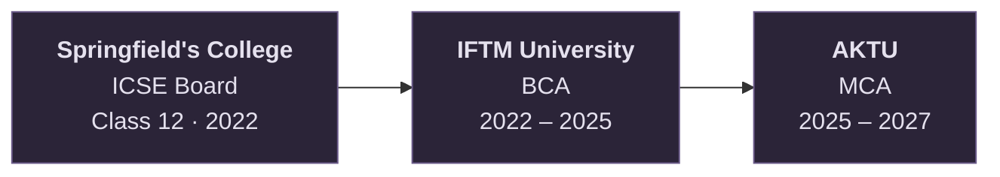

 

 

---

## ***About Me***

I'm Dhruv, a Business Analyst and MCA student. I enjoy analysing information and using data to support clear, informed decisions. I like approaching problems methodically, exploring how different pieces of information connect, and turning what I learn into practical work.

- **Interests:** Business analysis, data analytics, business intelligence, and problem-solving
- **Focus:** Strengthening my analytical, technical, and documentation skills through practical projects

---

## ***Tech Stack***

| Area | Tools and Skills |
|------|------------------|
| **Analytics and BI** | Power BI · DAX · Microsoft Excel · SQL |
| **Business Analysis** | BRD · FRD · Requirement Gathering · Business Documentation · Stakeholder Communication |
| **Documentation and Planning** | Confluence · Jira |
| **Version Control** | Git · GitHub |

---

## ***Experience***

<b>Business Analyst Intern — Hackshastra</b>

 

**Period:** August 2026 – Present

I am currently working as a Business Analyst Intern at Hackshastra. My work involves understanding business needs, analysing data, and presenting clear findings that help the team make informed decisions. I am also learning how real projects are planned, tracked, and documented in a professional setting.

**Skills:** Business Analysis · Requirement Gathering · BRD · FRD · Data Analysis · Power BI · Microsoft Excel · Jira · Confluence · Business Documentation · Stakeholder Communication · Business Problem-Solving

<b>Finance Intern — Suryavanshi Fine Serve</b>

 

**Period:** February 2026 – April 2026

At Suryavanshi Fine Serve, I worked as a Finance Intern and got hands-on exposure to how a financial services business operates. I worked with financial data, understood customer needs, and supported business development activities, which strengthened my interest in business analysis.

**Skills:** Business Analysis · Business Development · Financial Data Analysis · Market Research · Client Communication · Reporting · Microsoft Excel · Documentation

---

## ***Education***

<b>Master of Computer Applications (MCA) — Dr. A.P.J. Abdul Kalam Technical University (AKTU)</b>

 

**Period:** 2025 – 2027 (currently in semester 3)

During my MCA, I am building a stronger foundation in computing, databases, and software engineering. I am learning how data is stored and analysed, and how real software projects are planned and documented. This course is helping me connect technical knowledge with practical business problems, which is the direction I want my career to take.

**Skills:** Database Management · Data Analysis · Business Intelligence · Software Engineering · Project Documentation · Machine Learning Fundamentals

<b>Bachelor of Computer Applications (BCA) — IFTM University</b>

 

**Period:** 2022 – 2025

My BCA gave me the basics of computer science. I learned how databases, operating systems, and networks work, and how simple web pages are built. I also became comfortable with everyday office tools, especially Microsoft Excel, which later led me towards data analysis.

**Skills:** Web Development Basics · Database Concepts · Operating Systems · Computer Networks · Microsoft Excel

<b>Springfield's College — ICSE Board</b>

 

**Period:** Passed Class 12 in 2022

School built the base for everything that came after. Along with academics, I developed analytical thinking through mathematics, clear communication through English, and logical thinking through computer studies. It also taught me discipline, time management, and how to work well in a team.

**Skills:** Computer Applications · Mathematics · Analytical Thinking · English Communication · Time Management · Teamwork

---

## ***Featured Project: Madhumati Business Case Study***

A business case study analysing the annual sales performance of gold, diamond, and platinum products at Madhumati Jewelers. The project explores monthly sales trends and revenue-related performance to develop a clearer understanding of the business through data.

---

Thanks for stopping by. Feel free to explore my repositories or connect with me.

