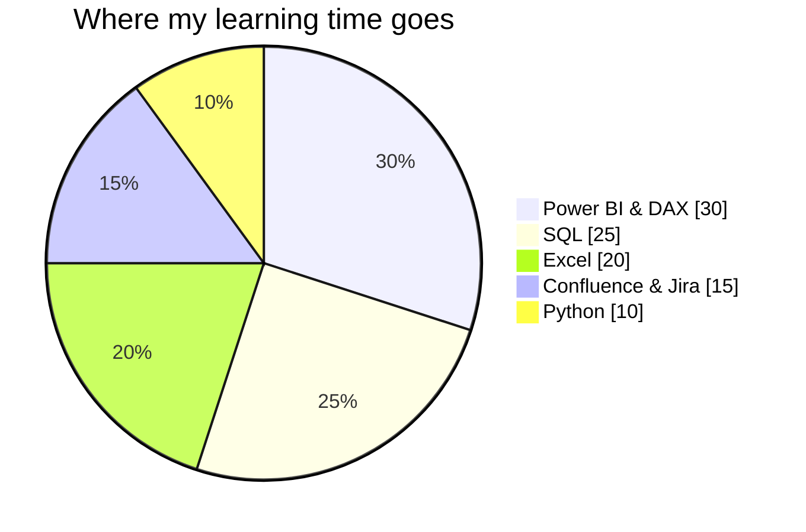
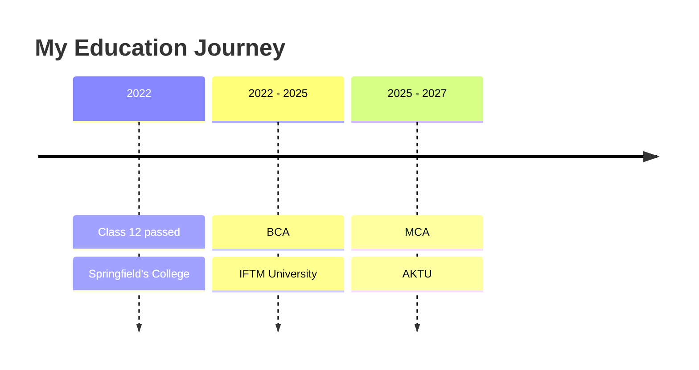

 

---

## ***About Me***

I'm Dhruv, an aspiring Business Analyst currently pursuing my Master of Computer Applications. I enjoy analysing information and using data to support clear, informed decisions. I like approaching problems methodically, exploring how different pieces of information connect, and turning what I learn into practical work.

- 🔎 **Interests:** Business analysis, data analytics, business intelligence, problem-solving
- 🌱 **Currently learning:** SQL and Confluence
- 📌 **Focus:** Strengthening my analytical, technical, and documentation skills through practical projects

---

## ***Tech Stack***

| Area | Tools |
|------|-------|
| **Analytics and BI** | Power BI · DAX · Microsoft Excel · SQL |
| **Documentation and Planning** | Confluence · Jira |
| **Programming** | Python |
| **Version Control** | Git · GitHub |

---

## ***Education***

<b>🎓 MCA — Dr. A.P.J. Abdul Kalam Technical University (AKTU)</b>

 

**Period:** 2025 – 2027 (currently in semester 3)

**Skills learned:**
- Python programming
- Database management and SQL
- Data analysis and business intelligence
- Software engineering and project documentation
- Machine learning fundamentals

<b>🎓 BCA — IFTM University</b>

 

**Period:** 2022 – 2025

**Skills learned:**
- Programming fundamentals (C, C++, Java)
- Web development basics (HTML, CSS)
- Database concepts and SQL basics
- Operating systems and computer networks
- Microsoft Excel and office tools

<b>🏫 Springfield's College — ICSE Board</b>

 

**Period:** Passed Class 12 in 2022

**Skills learned:**
- Computer applications and basic programming logic
- Mathematics and analytical thinking
- English communication and presentation
- Time management and discipline
- Teamwork and problem-solving

---

## ***Featured Project: Madhumati Business Case Study***

A business case study analysing the annual sales performance of gold, diamond, and platinum products at Madhumati Jewelers. The project explores monthly sales trends and revenue-related performance to develop a clearer understanding of the business through data.

---

## ***Contact***

**agrawaldhruv6523@gmail.com**

Thanks for stopping by. Feel free to explore my repositories or connect with me.

