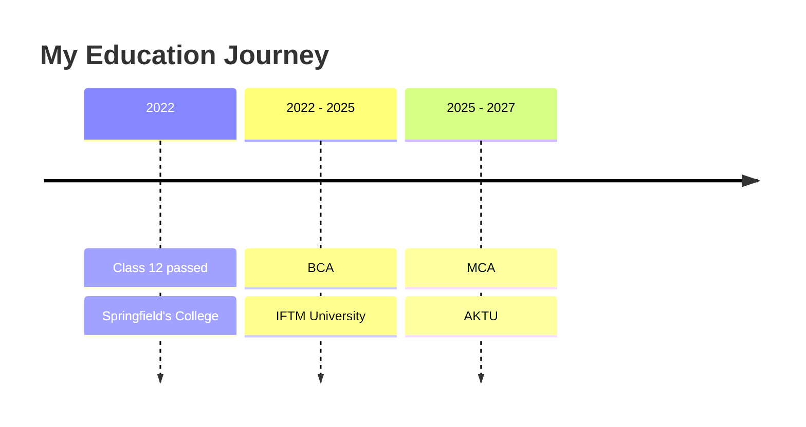

<h1 align="center">Dhruv Agrawal</h1>

 

 

---

## ***About Me***

I'm Dhruv, an aspiring Business Analyst currently pursuing my Master of Computer Applications. I enjoy analysing information and using data to support clear, informed decisions. I like approaching problems methodically, exploring how different pieces of information connect, and turning what I learn into practical work.

- **Interests:** Business analysis, data analytics, business intelligence, and problem-solving
- **Focus:** Strengthening my analytical, technical, and documentation skills through practical projects

---

## ***Tech Stack***

| Area | Tools |
|------|-------|
| **Analytics and BI** | Power BI · DAX · Microsoft Excel · SQL |
| **Documentation and Planning** | Confluence · Jira |
| **Version Control** | Git · GitHub |

---

## ***Education***

<b>Master of Computer Applications (MCA) — Dr. A.P.J. Abdul Kalam Technical University (AKTU)</b>

 

**Period:** 2025 – 2027 (currently in semester 3)

During my MCA, I am building a stronger foundation in programming, databases, and software engineering. I am learning how data is stored, queried, and analysed, and how real software projects are planned and documented. This course is helping me connect technical knowledge with practical business problems, which is the direction I want my career to take.

**Skills:** Python · Database Management and SQL · Data Analysis · Business Intelligence · Software Engineering · Project Documentation · Machine Learning Fundamentals

<b>Bachelor of Computer Applications (BCA) — IFTM University</b>

 

**Period:** 2022 – 2025

My BCA gave me the basics of computer science. I learned programming fundamentals, how databases and operating systems work, and how to build simple web pages. I also became comfortable with everyday office tools, especially Microsoft Excel, which later led me towards data analysis.

**Skills:** C · C++ · Java · HTML and CSS · Database Concepts · Operating Systems · Computer Networks · Microsoft Excel

<b>Springfield's College — ICSE Board</b>

 

**Period:** Passed Class 12 in 2022

School built the base for everything that came after. Along with academics, I developed analytical thinking through mathematics, clear communication through English, and basic programming logic through computer studies. It also taught me discipline, time management, and how to work well in a team.

**Skills:** Computer Applications · Mathematics · Analytical Thinking · English Communication · Time Management · Teamwork

---

## ***Featured Project: Madhumati Business Case Study***

A business case study analysing the annual sales performance of gold, diamond, and platinum products at Madhumati Jewelers. The project explores monthly sales trends and revenue-related performance to develop a clearer understanding of the business through data.

---

Thanks for stopping by. Feel free to explore my repositories or connect with me.

